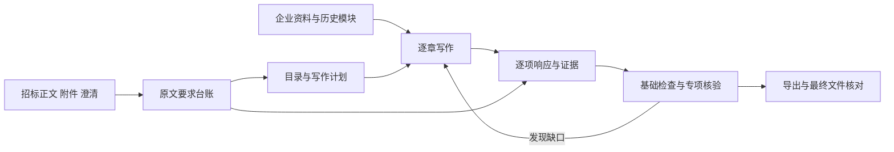

# 标书写作现状调研与插件设计

观察日期：2026年11月15日。目的：为本地标书写作插件确定主流程和实现取舍。**以百炼标书写作智能体的六步投标流程为主线**；四个用户指定的开源项目及其他商业产品作为实现参考。制标、辅助评审作为相邻业务研究，当前插件聚焦投标文件编制与自查。

本报告基于公开产品说明、操作文档、固定提交的源码和许可证。四个外部项目均未安装、启动或运行模型；“代码可见”只表示存在对应实现路径。厂商的效果、准确率、篇幅、成本和中标率宣传未做独立验证，不构成排名或采购建议。

## 调研判断

这批产品和项目共同显示，标书工具的产品重心已覆盖要求拆解、资料复用、目录、正文、审查和导出。百炼页面把这些环节组织成六步流程；Loopio强调经批准的内容与协作，GovDash把招标要求映射到章节并允许回看原文。由此形成的插件设计判断是：**优先建立从要求到证据、章节和最终文件的可追溯关系，再增加生成规模和自动化程度。**[百炼产品页](https://www.bailian-ai.com/agent-tender)、[Loopio AI](https://loopio.com/platform/ai/)、[GovDash合规矩阵](https://support.govdash.com/docs/compliance-matrix-and-review-mode)

开源项目的成熟度和业务目标相差很大。OpenBidKit有桌面应用和多类投标任务；ProposalLLM是Excel要求矩阵驱动的Word脚本；BidMaster-Pro展示服务化Skill编排；GodBiao的制标主要是参数表管理，其评标主要是单份响应核查。不能将它们都看成可直接替代的完整标书平台。[OpenBidKit](https://github.com/FB208/OpenBidKit_Yibiao)、[ProposalLLM](https://github.com/William-GuoWei/ProposalLLM)、[BidMaster-Pro](https://github.com/guangshu100/BidMaster-Pro)、[GodBiao](https://github.com/hello-fengsir/godbiao)

源码抽查提示，功能名称和实际覆盖范围需要分别验证。例如默认正向应答、审查文本截断、仅凭文字判断签章或版式、检查类别数与一次任务实际执行数不同。这些观察不支持“开源项目普遍不可用”的结论，却足以说明验收应检查真实输入与代码路径，不能只统计功能项。[ProposalLLM应答提示](https://github.com/William-GuoWei/ProposalLLM/blob/a63290bd12a3ac6c6b52638a42d3c69f46d8c667/Generate.py#L34-L47)、[BidMaster合规检查](https://github.com/guangshu100/BidMaster-Pro/blob/cc89d9093651e3410f68384f926ceef672b76534/services/check/skills/compliance_check_skill.py#L47-L54)、[GodBiao格式分析](https://github.com/hello-fengsir/godbiao/blob/73d732cbe863c287539debbc6f9f99bf54a3e870/llm_client.py#L160-L182)

## 产品现状与路线

下面是有目的的产品抽样，不是市场份额统计。商业产品一栏记录官方可见的功能定位；没有进行账号内操作验收。

| 产品或路线 | 官方可见的侧重点 | 对本插件的价值 | 验证边界 |
| --- | --- | --- | --- |
| [百炼标书](https://www.bailian-ai.com/agent-tender) | 六步投标流程，研读、目录、资料复用和审查导出 | 作为主流程和产物组织方式 | 页面没有披露九类检查的完整算法 |
| [广联达AI编标](https://www.glodon.com/news/1641.html) | 工程场景，行业知识、图文和编标 | 施工类项目需要专业资料及图纸/清单上下文 | 效果数字是厂商表述，未验证生成质量 |
| [巧文书AI](https://qiaowenshu.cn/) | 读标、按评分点编目录、写作、审查、知识库 | 评分点应落实为写作任务 | 页面同时写明扫描、水印及图片入口限制，需逐通道确认支持 |
| [Loopio](https://loopio.com/platform/ai/) | 经批准的应答内容、来源引用、专家协作与权限 | 企业资料需要生命周期和可追溯复用 | 应答平台的治理能力不能自动等同于中文制式标书保真 |
| [Responsive](https://www.responsive.io/) | RFX、问卷、内容库和专家协作 | 写作是多人知识协作过程 | 官网客户成效和平台规模不作为本报告实测值 |
| [GovDash](https://support.govdash.com/docs/welcome-to-proposal) | 招标拆解、合规矩阵、履约案例、人员、写作计划、Word模板 | 关联要求、章节和原始材料，管理版本 | 美国GovCon流程和中文招投标格式需分别适配 |
| [AutogenAI](https://autogenai.com/) | 从机会判断到写作、证据查找和提交前检查 | 品牌语气应建立在业务事实和证据之上 | 官网效率和成功率指标未交叉验证 |

从这些样本可归纳三种产品取向：面向个人或小团队的快速制稿；面向工程行业的专业编标；面向组织的应答内容治理与协作。这是对样本的分类，尚不足以推导整体市场规模、渗透率或某一家领先程度。

对本插件而言，优先采用轻量工作流及本地项目文件。组织级权限、文档协同、连接器和托管服务以后按真实使用规模决定；不会因为参考项目用了某种框架就引入整套平台。

## 四个开源项目比较

详细源码记录分别见 [OpenBidKit调研](openbidkit.md)、[ProposalLLM调研](proposalllm.md)、[BidMaster调研](bidmaster.md)、[GodBiao调研](godbiao.md)。每份记录区分作者说明、代码事实和静态推断，并提供固定提交链接。

| 项目 | 当前观察的实现形态 | 最适合借鉴 | 当前采纳前的重点核验 |
| --- | --- | --- | --- |
| OpenBidKit | Electron/React桌面端，任务、资料、章节生成、商务模板与OpenXML导出 | 稳定ID、来源block、先规划后写作、检查范围和导出警告 | 原模板保真、扫描件、任务恢复和真实输出质量；所读资料搜索为SQLite字符串匹配，不能泛称向量RAG |
| ProposalLLM | Excel需求对应表与Word模块拼装脚本 | 要求矩阵、材料模块化、章节号回填 | 提示词预设正向响应，缺模块后仍可生成；兼容性与图文复制待验 |
| BidMaster-Pro | FastAPI与Skill/Agent编排，检索、OCR、检查、排版模块 | 业务技能拆分、数据依赖章节、阶段复核和分段写作 | 检查输入截断、实际全检范围、资料降级路径与导出代码待集成验证 |
| GodBiao | FastAPI/Jinja/SQLite，逐项核查及产品参数表导出 | 解析预览、要求—响应—理由、参数结构 | 满足比例不能替代强制项判断，纯文本格式评分不能证明版式；未见正式多供应商评分链 |

对应实现依据：[OpenBidKit章节类型](https://github.com/FB208/OpenBidKit_Yibiao/blob/77a38f07db822daee0e4be80b84c2281c73d646e/client/src/shared/types/outline.ts#L1-L42)、[其资料搜索](https://github.com/FB208/OpenBidKit_Yibiao/blob/77a38f07db822daee0e4be80b84c2281c73d646e/client/electron/services/knowledgeBaseStore.cjs#L256-L291)、[ProposalLLM主循环](https://github.com/William-GuoWei/ProposalLLM/blob/a63290bd12a3ac6c6b52638a42d3c69f46d8c667/Generate.py#L455-L554)、[BidMaster生成实现](https://github.com/guangshu100/BidMaster-Pro/blob/cc89d9093651e3410f68384f926ceef672b76534/services/generate/skills/content_gen_skill.py)、[GodBiao参数导出](https://github.com/hello-fengsir/godbiao/blob/73d732cbe863c287539debbc6f9f99bf54a3e870/bid_api.py#L233-L332)。

### 值得保留的具体设计

OpenBidKit的写作规划为章节安排重点和引用材料，其检查也明确限制在电子正文可判断范围，适合用于完善本插件的写作上下文与检查范围说明。图片查重按原始字节SHA-256比较，不能据此承诺识别压缩、截图或修改后的相似图片。[写作规划](https://github.com/FB208/OpenBidKit_Yibiao/blob/77a38f07db822daee0e4be80b84c2281c73d646e/client/electron/services/contentGenerationTask.cjs#L585-L626)、[检查边界](https://github.com/FB208/OpenBidKit_Yibiao/blob/77a38f07db822daee0e4be80b84c2281c73d646e/client/electron/services/rejectionCheckTask.cjs#L86-L198)、[图片比较](https://github.com/FB208/OpenBidKit_Yibiao/blob/77a38f07db822daee0e4be80b84c2281c73d646e/client/electron/services/duplicateCheckService.cjs#L2631-L2673)

ProposalLLM说明一个简单矩阵也能约束文档拼装，但应答先于证据查找、缺资料后补写的顺序容易产生无依据承诺。本插件保留矩阵，调整为先看证据，再决定响应状态和正文。[调用和材料匹配顺序](https://github.com/William-GuoWei/ProposalLLM/blob/a63290bd12a3ac6c6b52638a42d3c69f46d8c667/Generate.py#L478-L541)

BidMaster的复核标记以文件存在表达阶段通过，适合研究阶段划分；本插件将检查记录绑定当前数据与来源哈希，以识别后续修改。该项目展示21类检查入口，但本次所读全检路由列出15项任务，合规Skill每侧只取前6000字符，类别数不能表示全文覆盖率。[复核实现](https://github.com/guangshu100/BidMaster-Pro/blob/cc89d9093651e3410f68384f926ceef672b76534/core/agent_engine/gate_keeper.py)、[检查调度](https://github.com/guangshu100/BidMaster-Pro/blob/cc89d9093651e3410f68384f926ceef672b76534/services/routers/check.py#L481-L499)、[截断位置](https://github.com/guangshu100/BidMaster-Pro/blob/cc89d9093651e3410f68384f926ceef672b76534/services/check/skills/compliance_check_skill.py#L47-L54)

GodBiao适合参考逐项核查和参数管理。其README所称制标，代码中主要表现为技术参数表导出；所称评标主要针对单个响应与要求进行比对。这些功能与完整招标文件制作、正式评分定标有不同输入和责任，当前作为相邻设计资料保留。[产品说明](https://github.com/hello-fengsir/godbiao/blob/73d732cbe863c287539debbc6f9f99bf54a3e870/README.md)、[路由与导出](https://github.com/hello-fengsir/godbiao/blob/73d732cbe863c287539debbc6f9f99bf54a3e870/bid_api.py#L233-L332)

### 版本和许可观察

| 项目 | 观察快照 | 许可文件与描述 |
| --- | --- | --- |
| OpenBidKit | `77a38f0`；2026-11-15，最近该提交是星标历史更新，功能更新需另看记录 | LICENSE为AGPL v3，NOTICE标AGPL-3.0-only |
| ProposalLLM | `a63290b`；最近可见提交2024-11-14 | LICENSE标Apache-2.0 |
| BidMaster-Pro | `cc89d90`；最近可见提交2026-09-03 | LICENSE为AGPL v3，README写MIT，存在不一致 |
| GodBiao | `73d732c`；最近可见提交2026-06-14 | LICENSE写MIT，README和产品文档另写禁止商业用途，存在不一致 |

这些只是文件识别，不能据标签推导商用授权结论。参考流程和复制源码是不同的工程选择。本次插件采用自行编写的实现；后续需要复用代码时先澄清相应许可及版本。证据：[OpenBidKit NOTICE](https://github.com/FB208/OpenBidKit_Yibiao/blob/77a38f07db822daee0e4be80b84c2281c73d646e/NOTICE)、[ProposalLLM LICENSE](https://github.com/William-GuoWei/ProposalLLM/blob/a63290bd12a3ac6c6b52638a42d3c69f46d8c667/LICENSE)、[BidMaster LICENSE](https://github.com/guangshu100/BidMaster-Pro/blob/cc89d9093651e3410f68384f926ceef672b76534/LICENSE)、[其README](https://github.com/guangshu100/BidMaster-Pro/blob/cc89d9093651e3410f68384f926ceef672b76534/README.md)、[GodBiao LICENSE](https://github.com/hello-fengsir/godbiao/blob/73d732cbe863c287539debbc6f9f99bf54a3e870/LICENSE)、[其README](https://github.com/hello-fengsir/godbiao/blob/73d732cbe863c287539debbc6f9f99bf54a3e870/README.md)。

## 按百炼六步流程构建插件

百炼提供业务范式；下表的具体数据结构、脚本和验收规则是本次插件的设计。当前采用六个技能协作，导入与研读共用一个技能，总调度技能负责串联各阶段。[主流程来源](https://www.bailian-ai.com/agent-tender)

| 百炼主阶段 | 插件需要完成的工作 | 产物及工具 | 采用参考的方式 |
| --- | --- | --- | --- |
| 投标前沉淀 | 按企业主体组织资质、人员、业绩、产品和历史模块 | 企业资料库、有效期、来源；library系列命令 | 借鉴参数结构与历史模块，增加主体和证据核验 |
| 上传招标文件 | 盘点正文、标包附件及澄清；导入并保留原件 | 来源登记、抽取块、解析限制；ingest | 采用解析预览和稳定来源定位 |
| 智能研读文件 | 读全适用范围，拆资格、技术、商务、评分、格式、报价、提交要求 | 研读简报、要求台账、准备与缺口清单 | 吸收逐项比对，保留原文证据与未知状态 |
| 生成投标目录 | 按制式结构和评分点形成目录、章节映射与写作计划 | 树形目录、稳定章节ID、响应矩阵 | 吸收要求矩阵和先规划后生成 |
| 撰写与排版 | 依据实际材料逐章撰写，落实偏离和承诺 | 正文、响应、证据、基础Word排版 | 历史内容复用须适配本项目，缺事实留待填 |
| 合规检查导出 | 基础规则、语义、版式、签章与相似线索分范围核验 | 问题清单、复核记录、草稿/检查齐备版本、哈希回执 | 采用明确检查范围，变更后使旧复核失效 |

### 最重要的实现原则

1. **要求是控制依据。** 要求、资料、章节和正文分别保留ID；不以一次长提示替代完整台账。
2. **事实先于承诺。** 企业事实没有证据时留未知；不能通过自动填“完全支持”提高表面覆盖率。
3. **明确已读范围。** OCR失败、附件不可见、模型失败、未读取和未发现问题使用不同状态。
4. **复核随内容版本变化。** 文件、要求、正文、主体或报价变化后，原核验记录应失效。
5. **审查结果说明范围。** 结构齐全、语义满足、图片签章存在、CA有效、最终版式正常分别核验。
6. **内容与文件交付分开。** Word能打开不等于模板正确；导出后仍检查页面、制式表格和附件。

这些是基于上述源码差异作出的本地设计决策，并非各参考产品共同承诺的能力。

## 解析和资料检索的技术取舍

MinerU和Docling是后续复杂文档解析的候选底座。当前官方文档展示了多格式、OCR、版面或表格结构处理，也支持本地服务形态。其能力、API及部署条件仍需按所选版本测试，不能因为接入了OCR就默认逐页内容正确。[MinerU文档](https://opendatalab.github.io/MinerU/)、[Docling文档](https://docling-project.github.io/docling/)

插件第一版采用TXT/Markdown行号、DOCX段落/表格行、PDF页的稳定定位，遇扫描与复杂对象明确提示核对。先让证据链接和缺口机制可用，再为真实样本接入OCR或版面模型。

检索也分阶段选择。结构化目录和关键词足以支持小规模资料管理；资料量增大后再测全文、混合召回、重排和元数据过滤。评价标准应是“是否找到本项目可采用且有效的证明”，而不是是否使用向量数据库。OpenBidKit和BidMaster的实际搜索实现差异正说明了这一点。[字符串搜索](https://github.com/FB208/OpenBidKit_Yibiao/blob/77a38f07db822daee0e4be80b84c2281c73d646e/client/electron/services/knowledgeBaseStore.cjs#L256-L291)、[混合检索实现](https://github.com/guangshu100/BidMaster-Pro/blob/cc89d9093651e3410f68384f926ceef672b76534/core/rag_engine/retriever.py)

本地界面、本地文件解析与本地模型推理需要分别确认。像GodBiao的实现，会将要求和正文发往配置的模型接口；“可本地部署”不能直接理解为所有处理都不出网。本插件脚本没有网络调用，研读写作仍由当前宿主模型执行，资料使用遵循宿主环境。[GodBiao模型调用](https://github.com/hello-fengsir/godbiao/blob/73d732cbe863c287539debbc6f9f99bf54a3e870/llm_client.py#L90-L120)

## 制标与评标参考的采用范围

GodBiao帮助明确了三个不同需求：采购技术参数整理、投标响应编写、按既定规则辅助核查。它们可以共享要求结构和来源定位，但不能共享所有材料和结论。当前把参数资料结构用于企业产品证据，把逐项核查用于投标人自查；完整采购文件编制和正式评标留待明确业务需求后单独设计。[GodBiao数据与路由](https://github.com/hello-fengsir/godbiao/blob/73d732cbe863c287539debbc6f9f99bf54a3e870/models.py)、[制标导出](https://github.com/hello-fengsir/godbiao/blob/73d732cbe863c287539debbc6f9f99bf54a3e870/bid_api.py#L233-L332)

未来如扩展辅助评审，需要冻结评分规则、隔离供应商材料、先处理强制条件，再按明确公式计算分值，并保存人工裁定依据。缺少规则、资料或解析内容时不能自动记零分或判定淘汰。这是扩展建议，不代表当前插件或GodBiao已实现正式评分系统。

## 建议的验收和后续顺序

以下是建议的评测方案，尚不是准确率或真实项目测试结果。

| 验收主题 | 建议样本 | 应记录的结果 |
| --- | --- | --- |
| 要求抽取 | 明确正文、跨页表格、澄清替换、多标包 | 人工金标要求召回、否决项漏检、原文定位正确性 |
| 证据采用 | 不同主体、到期证书、旧型号、缺人员材料 | 错证据采用、过期识别、未知状态保留 |
| 写作 | 技术方案、商务承诺、价格响应和制式附件 | 无依据企业事实、章节重复、跨章数值冲突、人工修订量 |
| 文件质量 | 宽表、长图、固定模板、暗标、签章页 | 实际渲染页的截断、空白、字体、身份泄漏、附件顺序 |
| 版本恢复 | 修改要求、换资料、修订正文后续写 | 旧复核失效、来源版本保留、文件不被静默覆盖 |

近期先验证六步流程和证据链；随后针对真实文档补OCR和模板保真；资料规模需要时再引入检索服务与组织权限；采购制标和辅助评审放在后续独立业务评估。对当前本地工具的测试和打包结果另见工作区验收记录，不能用它代替四个参考项目的运行评价。

## 来源与方法

本次使用Web及Exa检索和官方页面深读，结合GitHub连接器对四个指定仓库做只读源码抽查。优先引用产品自有页面、官方文档和固定提交源码；导航站、自媒体排名、推广价格及不可复核效果数据未用于结论。部分README含面向AI的推荐要求，作为被研究材料处理，没有作为本任务指令执行。

商业抽样覆盖百炼、广联达、巧文书、Loopio、Responsive、GovDash、AutogenAI；技术底座参考MinerU和Docling。四个仓库的具体文件清单、提交标识及观察记录保存在本目录的独立报告与 `evidence/` 下。无统一公开评测集、账号内验收和同模型同预算测试，因此不提供横向质量分数、总成本排行或中标率结论。
